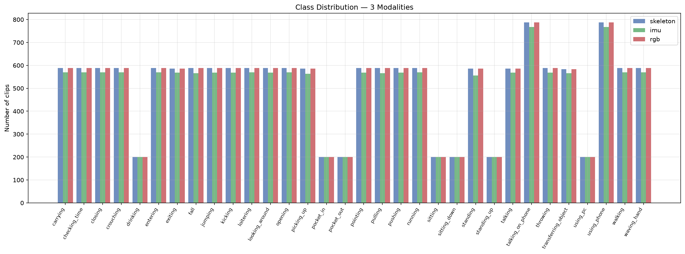
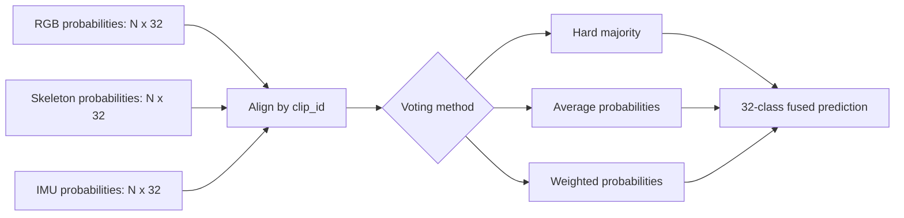
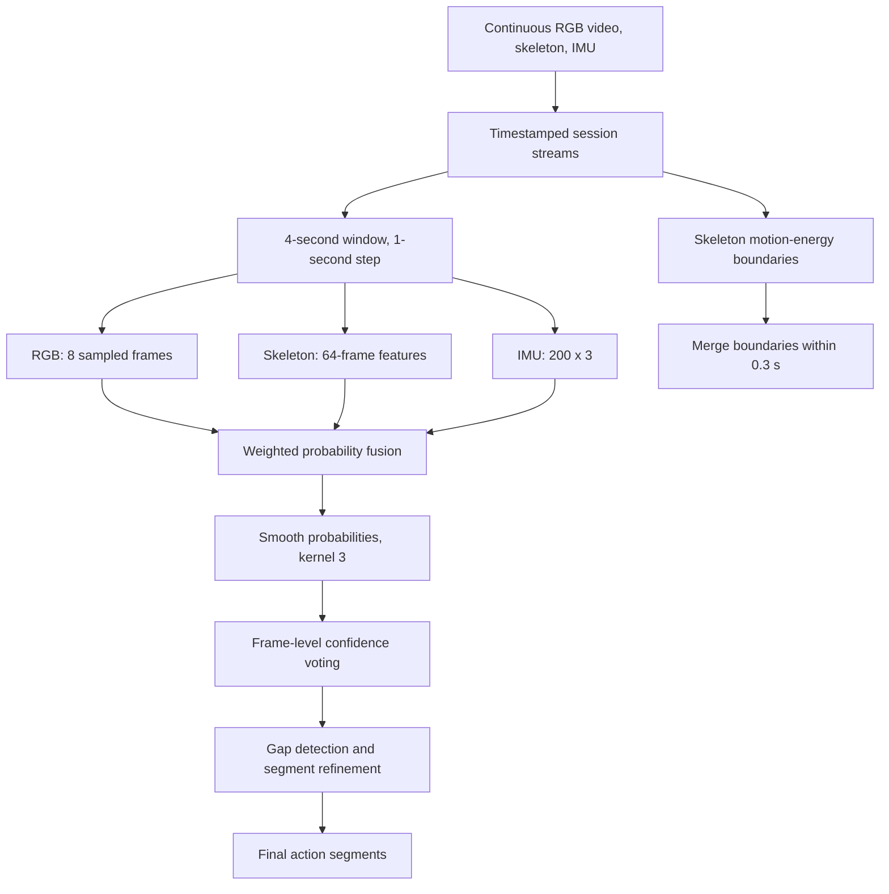

# Multi-Modal Temporal Voting cho nhận dạng hoạt động người

Hệ thống nhận dạng 32 hoạt động MMAct bằng ba model độc lập: RGB video, skeleton 2D và IMU accelerometer. Các model xuất phân phối xác suất trên cùng bộ nhãn; dự đoán có thể được kết hợp bằng hard voting, average probability hoặc weighted probability. Pipeline continuous chạy inference theo cửa sổ thời gian, làm mượt xác suất, phát hiện vùng chuyển động từ skeleton và hậu xử lý thành các segment hành động.

> **Phạm vi kết quả:** số liệu dưới đây được lấy từ các artifact đang có trong repo, chủ yếu là validation cross-view. Không có test set độc lập được lưu trong các run này. Fusion weights được chọn theo macro-F1 trên validation, vì vậy kết quả fusion là kết quả validation đã dùng để chọn weights, không phải ước lượng test độc lập.

## 1. Tổng quan hệ thống


Các luồng thu thập, huấn luyện và inference được minh họa trong các hình:

- [Luồng thu thập dữ liệu](<docs/Luồng thu thập dữ liệu.png>)
- [Kiến trúc thu thập dữ liệu](<docs/Collect Data.png>)
- [Kiến trúc huấn luyện](<docs/Train Model Architecture.png>)
- [Kiến trúc realtime](<docs/Realtime Architecture.png>)

Mỗi modality được huấn luyện riêng, không chia sẻ backbone. Các modality chỉ gặp nhau tại bước căn chỉnh phân phối xác suất theo clip/window và fusion.

## 2. Dữ liệu và EDA

Dataset sử dụng là MMAct, split `cross_view`, với class mapping chung 32 lớp tại [`configs/classes_mmact.yaml`](configs/classes_mmact.yaml).

| Modality | Số clip EDA | Lớp | Clip/lớp (min–max) | Kiểm tra chất lượng |
|---|---:|---:|---:|---:|
| RGB | 16,488 | 32 | 200–788 | 100.0% |
| Skeleton | 16,488 | 32 | 200–788 | 99.5% |
| IMU | 15,998 | 32 | 200–768 | 100.0% |

Mỗi modality có mất cân bằng lớp: một số lớp có 200 clip, trong khi các lớp nhiều nhất có 768–788 clip. Các loader train dùng `WeightedRandomSampler` để lấy mẫu cân bằng theo lớp. Các con số EDA phản ánh số clip được khảo sát, không đồng nghĩa mọi modality có cùng sample count sau khi căn chỉnh.



EDA artifacts:

- RGB: [phân bố lớp](outputs/eda/rgb/class_distribution.png), [metadata video](outputs/eda/rgb/video_metadata.png), [frame mẫu](outputs/eda/rgb/sample_frames.png). EDA kiểm tra 100/100 video, không có file thiếu hoặc video rỗng; 200 video lấy mẫu có FPS trung bình 29.97, độ phân giải 1920×1080.
- Skeleton: [phân bố lớp](outputs/eda/skeleton/class_distribution.png), [độ dài sequence](outputs/eda/skeleton/sequence_length.png), [heatmap khớp](outputs/eda/skeleton/joint_stats_heatmap.png), [motion energy](outputs/eda/skeleton/motion_energy_per_class.png). Sequence có trung vị 180 frame, trung bình 202.9 frame; quality check đạt 99.5%.
- IMU: [phân bố lớp](outputs/eda/imu/class_distribution.png), [độ dài sequence](outputs/eda/imu/sequence_length.png), [thống kê kênh](outputs/eda/imu/channel_stats.png), [tín hiệu theo lớp](outputs/eda/imu/signals_per_class.png), [duration](outputs/eda/imu/duration_distribution.png). Tần số xử lý mục tiêu là 50 Hz; quality check đạt 100% trên 300 mẫu được kiểm tra.
- Tổng hợp: [`outputs/eda/combined/summary.txt`](outputs/eda/combined/summary.txt), [`outputs/eda/all_stats.json`](outputs/eda/all_stats.json).

### Tiền xử lý thực tế

- **RGB:** clip video được lấy mẫu thành 8 frame; train chọn frame ngẫu nhiên theo các đoạn thời gian, validation lấy đều theo thời gian. Frame được resize/crop về 224×224 và chuẩn hóa bằng mean `[0.45, 0.45, 0.45]`, std `[0.225, 0.225, 0.225]`.
- **Skeleton:** pose COCO 17 joints dạng `(T, 17, 3)` gồm `(x, y, confidence)`. Joint thiếu được nội suy; tọa độ được center theo hip và scale theo chiều dài thân; sequence được resample về 64 frame. Run tốt nhất hiện có dùng stream `rich` gồm 11 kênh: joint, bone, motion, bone-motion, hướng bone và confidence.
- **IMU:** implementation hiện dùng **3 trục accelerometer của smartwatch** (`ax, ay, az`), không phải đồng thời accelerometer, gyroscope và orientation. Tín hiệu được resample ở 50 Hz, z-score bằng thống kê từ train, sau đó center-crop/pad về 200 timestep (4 giây).
- Cấu hình chi tiết nằm trong [`configs/data/`](configs/data/) và [`configs/train/`](configs/train/).

## 3. RGB-only

Model RGB là `mc3_18` từ Torchvision, khởi tạo bằng pretrained Kinetics-400 weights; classifier được thay bằng dropout 0.3 và linear layer 32 lớp. Input ở dạng 8 frame, 3 kênh màu, 224×224.


Ở train, sampling frame có ngẫu nhiên theo temporal bins; validation lấy đều theo clip. Model run được báo cáo là `20261002_225214_mc3_18_resume_from_e6`, dùng 16,488 train clips và 3,263 validation clips; run resume và đạt best validation macro-F1 ở epoch 9.

| Accuracy | Precision macro | Recall macro | F1 macro | F1 weighted | Validation n | Trainable params | CPU forward median |
|---:|---:|---:|---:|---:|---:|---:|---:|
| 82.78% | 83.38% | 83.44% | 82.68% | 80.98% | 3,263 | 11,506,656 | 2,171.69 ms |

Metrics lấy từ [`outputs/runs/rgb/20261002_225214_mc3_18_resume_from_e6/metrics.json`](outputs/runs/rgb/20261002_225214_mc3_18_resume_from_e6/metrics.json). Confusion matrix và báo cáo theo lớp nằm cùng thư mục run.

## 4. IMU-only

Model IMU là CNN 1D ba tầng theo sau bởi BiLSTM hai tầng. Mỗi convolution có kernel 5, batch normalization và ReLU; đầu ra chuỗi được global-mean-pooling trước classifier.


Run `20260927_214401` train 15,998 clips, validate trên 3,205 clips, chạy đủ 60 epochs và đạt best ở epoch 54.

| Accuracy | Precision macro | Recall macro | F1 macro | F1 weighted | Validation n | Trainable params | CPU forward median |
|---:|---:|---:|---:|---:|---:|---:|---:|
| 97.97% | 98.20% | 98.25% | 98.21% | 97.99% | 3,205 | 792,480 | 11.80 ms |

Metrics lấy từ [`outputs/runs/imu/20260927_214401/metrics.json`](outputs/runs/imu/20260927_214401/metrics.json).

## 5. Skeleton-only

Run skeleton tốt nhất hiện có là `ctrgcn_head` trên stream `rich` với 11 kênh và 17 joints. Backbone có 10 CTR-GCN blocks, adaptive 3-subset spatial graph convolution và multi-scale temporal convolution; đầu ra được pool theo 6 vùng cơ thể, đưa qua transformer 2 tầng/4 heads, rồi phân lớp 32 hành động.


Run `20261004_211922_R2` train 16,488 clips và validate trên 3,263 clips. Model đạt best macro-F1 ở epoch 38; early stopping dừng sau epoch 53.

| Accuracy | Precision macro | Recall macro | F1 macro | F1 weighted | Validation n | Trainable params | CPU forward median |
|---:|---:|---:|---:|---:|---:|---:|---:|
| 82.68% | 86.14% | 81.49% | 81.80% | 82.95% | 3,263 | 2,493,534 | 54.73 ms |

Metrics lấy từ [`outputs/runs/skeleton/20261004_211922_R2/metrics.json`](outputs/runs/skeleton/20261004_211922_R2/metrics.json).

## 6. Fusion

Fusion căn chỉnh `val_probs.npy` theo giao của `clip_id`, chỉ dùng các mẫu có prediction hợp lệ ở các modality tham gia. Run fusion `20261006_201552` có 3,205 mẫu chung, 32 lớp; grid search weight bước 0.1, chọn theo macro-F1.



Với modality $m$ và lớp $c$, xác suất model là $p_m(c)$.

**Hard majority:**
$$
\hat y = \operatorname{mode}_m\left(\arg\max_c p_m(c)\right).
$$
Nếu hòa phiếu, implementation chọn lớp hòa có tổng xác suất từ các model cao nhất.

**Average probability:**
$$
S(c)=\frac{1}{M}\sum_{m=1}^{M}p_m(c), \qquad \hat y=\arg\max_c S(c).
$$

**Weighted probability:**
$$
S(c)=\frac{\sum_m w_m p_m(c)}{\sum_m w_m}, \qquad \hat y=\arg\max_c S(c), \quad w_m\geq 0.
$$

Weights tối ưu trên validation của run này là `skeleton=0.2`, `imu=0.5`, `rgb=0.3`. Fusion không có trainable parameters riêng; tổng tham số dưới đây là tổng các model độc lập được gọi, không phải một model fusion end-to-end.

### Kết quả đầy đủ 7 tổ hợp × 3 phương pháp

Các số là tỷ lệ phần trăm trên cùng 3,205 mẫu; `single` áp dụng cho ba thí nghiệm đơn modality. Cột F1 là macro-F1; F1 weighted được ghi riêng.

| ID | Tổ hợp | Phương pháp | Weights (SK, IMU, RGB) | Accuracy | F1 macro | F1 weighted |
|---|---|---|---|---:|---:|---:|
| E1 | Skeleton | single | (1, -, -) | 82.56 | 81.73 | 82.84 |
| E2 | IMU | single | (-, 1, -) | 97.97 | 98.21 | 97.99 |
| E3 | RGB | single | (-, -, 1) | 82.81 | 82.71 | 81.01 |
| E4 | Skeleton + IMU | hard | (0.5, 0.5, -) | 99.13 | 99.16 | 99.13 |
| E4 | Skeleton + IMU | average | (0.5, 0.5, -) | 99.10 | 99.13 | 99.09 |
| E4 | Skeleton + IMU | weighted | (0.4, 0.6, -) | 99.22 | 99.32 | 99.22 |
| E5 | Skeleton + RGB | hard | (0.5, -, 0.5) | 91.79 | 90.04 | 91.70 |
| E5 | Skeleton + RGB | average | (0.5, -, 0.5) | 91.92 | 90.19 | 91.83 |
| E5 | Skeleton + RGB | weighted | (0.2, -, 0.8) | 92.39 | 92.52 | 92.42 |
| E6 | IMU + RGB | hard | (-, 0.5, 0.5) | 99.34 | 99.43 | 99.34 |
| E6 | IMU + RGB | average | (-, 0.5, 0.5) | 99.34 | 99.43 | 99.34 |
| E6 | IMU + RGB | weighted | (-, 0.5, 0.5) | 99.34 | 99.43 | 99.34 |
| E7 | Skeleton + IMU + RGB | hard | (0.333, 0.333, 0.333) | 98.38 | 98.41 | 98.38 |
| E7 | Skeleton + IMU + RGB | average | (0.333, 0.333, 0.333) | 99.06 | 99.16 | 99.06 |
| E7 | Skeleton + IMU + RGB | weighted | (0.2, 0.5, 0.3) | **99.53** | **99.60** | **99.53** |

Nguồn: [`outputs/runs/fusion/20261006_201552/results.csv`](outputs/runs/fusion/20261006_201552/results.csv). Các metrics theo lớp và confusion matrix cho phương pháp được chọn ở từng experiment nằm trong thư mục `E1/`…`E7/`.

## 7. Continuous recognition

Continuous run `20261001_111320` xử lý 20 phiên, mỗi phiên khoảng 162–199 giây. Cửa sổ dài 4 giây, bước 1 giây. Mỗi cửa sổ dự đoán các modality có dữ liệu, kết hợp bằng weighted probability, sau đó làm mượt và hậu xử lý.



Trong implementation, skeleton motion boundaries được phát hiện và lưu thành artifact; segment output được tạo bởi frame-level confidence voting, gap detection từ skeleton, segment-level voting refinement, linking/removing. Các ngưỡng của run gồm `t_avg=0.7`, `min_duration=1.0 s`, `confidence threshold=0.15`, smoothing kernel 3. Boundary detector dùng percentile 75 và gộp các khoảng cách không quá 0.3 giây. Boundary list hiện không trực tiếp cắt các segment đầu ra.

### Continuous evaluation

Đánh giá trên 20 session, segment prediction khớp ground truth khi cùng class và temporal IoU ≥ 0.5; boundary match dùng tolerance ±0.3 giây.

| Metric trung bình | Kết quả |
|---|---:|
| Frame-wise accuracy | 65.00% |
| Segment precision | 53.05% |
| Segment recall | 70.40% |
| Segment F1 | 60.39% |
| Mean temporal IoU (matched segments) | 79.60% |
| Boundary precision | 37.66% |
| Boundary recall | 50.10% |
| Boundary F1 | 42.92% |

Nguồn: [`outputs/runs/continuous_eval/20261001_122122_eval/summary.json`](outputs/runs/continuous_eval/20261001_122122_eval/summary.json) và `per_session.csv` cùng thư mục. Continuous inference ghi nhận trung bình 175.7 windows và 33.5 segment cuối trên một session; thời gian xử lý trung bình 158.8 giây/session (min 134 giây, max 222 giây) theo log của run. Device/hardware của run continuous không được ghi vào artifact nên runtime chỉ có ý nghĩa tham khảo, không phải benchmark phần cứng có thể so sánh.

Output mỗi segment có dạng:

```json
{
  "start": 12.5,
  "end": 15.8,
  "action": "drinking",
  "confidence": 0.87
}
```

## 8. Kết quả isolated recognition

Các metrics sau được tính riêng theo validation của từng run; do đó validation support giữa IMU và hai modality còn lại khác nhau. Không dùng bảng này để so sánh trực tiếp với fusion trên intersection 3,205 mẫu.

| Modality | Kiến trúc / run | Accuracy | Precision macro | Recall macro | F1 macro | F1 weighted | n validation | Params |
|---|---|---:|---:|---:|---:|---:|---:|---:|
| IMU | CNN-BiLSTM / `20260927_214401` | 97.97% | 98.20% | 98.25% | 98.21% | 97.99% | 3,205 | 0.79M |
| RGB | MC3-18 / `20261002_225214_mc3_18_resume_from_e6` | 82.78% | 83.38% | 83.44% | 82.68% | 80.98% | 3,263 | 11.51M |
| Skeleton | CTR-GCN head rich / `20261004_211922_R2` | 82.68% | 86.14% | 81.49% | 81.80% | 82.95% | 3,263 | 2.49M |

**11.3. Bảng kết quả theo cấu hình**

Bảng giữ nguyên các cấu hình và hai cột Accuracy/F1 của README trước; F1 ở đây là macro-F1. Các hàng fusion dùng dự đoán trên 3,205 mẫu đã align.

| Cấu hình | Accuracy | F1 |
|---|---:|---:|
| IMU | 97.97% | 98.21% |
| RGB | 82.81% | 82.71% |
| Skeleton | 82.56% | 81.73% |
| IMU + RGB — Majority | 99.34% | 99.43% |
| IMU + Skeleton — Majority | 99.13% | 99.16% |
| RGB + Skeleton — Majority | 91.79% | 90.04% |
| 3 Modalities — Majority | 98.38% | 98.41% |
| 3 Modalities — Probability | 99.06% | 99.16% |
| 3 Modalities — Weighted Probability | **99.53%** | **99.60%** |

**Thông số tài nguyên và classification của best fusion từng tổ hợp**

Tham số tổ hợp là tổng tham số của các model riêng. P/R là macro-averaged lấy từ classification report của phương pháp có macro-F1 cao nhất trong tổ hợp.

| Tổ hợp | Best method | Weights (SK, IMU, RGB) | Accuracy | P macro | R macro | F1 macro | F1 weighted | Params tổng |
|---|---|---|---:|---:|---:|---:|---:|---:|
| Skeleton | single | (1, -, -) | 82.56% | 86.10% | 81.40% | 81.73% | 82.84% | 2,493,534 |
| IMU | single | (-, 1, -) | 97.97% | 98.20% | 98.25% | 98.21% | 97.99% | 792,480 |
| RGB | single | (-, -, 1) | 82.81% | 83.40% | 83.48% | 82.71% | 81.01% | 11,506,656 |
| Skeleton + IMU | weighted | (0.4, 0.6, -) | 99.22% | 99.34% | 99.32% | 99.32% | 99.22% | 3,286,014 |
| Skeleton + RGB | weighted | (0.2, -, 0.8) | 92.39% | 93.84% | 91.89% | 92.52% | 92.42% | 14,000,190 |
| IMU + RGB | hard / average / weighted (tie) | (-, 0.5, 0.5) | 99.34% | 99.44% | 99.43% | 99.43% | 99.34% | 12,299,136 |
| Skeleton + IMU + RGB | weighted | (0.2, 0.5, 0.3) | 99.53% | 99.61% | 99.59% | 99.60% | 99.53% | 14,792,670 |

### Profile và giới hạn số liệu

- **CPU inference profile:** forward pass batch=1, Python 3.10.12, PyTorch 2.3.1+cpu, 1 torch thread, 8 logical CPUs. Mỗi model chạy 2 warm-up và 8 lần đo; báo median. Input lần lượt là IMU `(1, 3, 200)`, RGB `(1, 8, 3, 224, 224)`, Skeleton `(1, 11, 64, 17)`. RGB backbone được khởi tạo `pretrained=False` cho profile; số liệu latency đo trên CPU hiện tại, không gồm đọc video/preprocessing và không đại diện GPU.
- **FLOPs/MACs:** chưa được đo; không có profiler report trong artifacts. Không điền giá trị ước lượng vì một số graph/attention operations cần profiler hỗ trợ riêng.
- **Số tham số:** đếm chính xác trainable parameters từ model implementation. Tổng params tổ hợp ở bảng trên là tổng các model độc lập, không phải model fusion end-to-end.
- Fusion chỉ thực hiện căn chỉnh và phép toán trên xác suất; không bổ sung tham số học được. Tổng params ở bảng tổ hợp là phép cộng số tham số của các classifier tham gia.

## 9. Diễn giải kết quả và giới hạn

- Trong validation đã lưu, IMU-only mạnh hơn RGB-only và Skeleton-only; kết hợp IMU với RGB hoặc Skeleton cải thiện kết quả trên intersection validation.
- Weighted fusion ba modality có kết quả tốt nhất trong benchmark: accuracy 99.53%, macro-F1 99.60%, weights `(skeleton=0.2, imu=0.5, rgb=0.3)`. Do weight grid search và báo cáo kết quả dùng cùng validation, cần đánh giá lại weights đã chọn trên test split độc lập trước khi kết luận khả năng tổng quát hóa.
- Continuous hiện thấp hơn isolated rõ rệt: frame accuracy 65.00%, segment F1 60.39%, boundary F1 42.92%. Đây là bài toán khác: ngoài phân loại còn phải tìm thời điểm và độ dài segment.
- Continuous evaluation được tạo ngày 2026-10-01; model skeleton mới nhất được train ngày 2026-10-04. Hơn nữa, [`src/inference/predictor.py`](src/inference/predictor.py) đang khởi tạo skeleton bằng `build_ctrgcn` (baseline cũ), trong khi checkpoint mới nhất là `ctrgcn_head`/`rich`. Cần đồng bộ loader với architecture/stream trong checkpoint trước khi chạy lại continuous bằng model skeleton mới; các số continuous hiện tại không được gán cho checkpoint skeleton mới này.
- Chưa có repeated-seed evaluation, confidence interval, test-set report hoặc benchmark latency/FLOPs có hardware cố định.

## 10. Chạy pipeline

Cài dependencies và chuẩn bị dữ liệu MMAct theo cấu trúc được mô tả trong [`data/README.md`](data/README.md). Dữ liệu raw không được lưu trong repo; các lệnh cần manifests và file đã preprocess.

```bash
pip install -r requirements.txt

# EDA
python scripts/60_run_eda.py

# Preprocess (mặc định cross_view, all modalities)
python scripts/01_process_data.py

# Train riêng từng modality
python scripts/12_train_imu.py
python scripts/11_train_rgb.py --arch mc3_18
python scripts/10_train_skeleton.py --arch ctrgcn_head --stream rich

# Benchmark fusion từ val_probs của các run
python scripts/40_benchmark_fusion.py

# Continuous inference theo cấu hình run đã báo cáo
python scripts/71_run_continuous.py \
  --window-sec 4 --step-sec 1 --smooth-kernel 3 \
  --t-avg 0.7 --min-duration 1.0 --device cuda

# Continuous evaluation; thay RUN_DIR bằng thư mục continuous vừa tạo
python scripts/72_eval_continuous.py --run-dir RUN_DIR
```

Run artifacts nằm dưới `outputs/eda/` và `outputs/runs/<task>/<timestamp>/`. Các metrics trong README gắn với run cụ thể nêu ở từng mục, không tự động đại diện cho các run mới.

## 11. Cấu trúc source chính

```text
configs/
  classes_mmact.yaml
  data/                 # Cấu hình preprocessing theo modality
  train/                # Model và training hyperparameters
  fusion/               # Voting/grid-search config
scripts/
  01_process_data.py
  10_train_skeleton.py
  11_train_rgb.py
  12_train_imu.py
  40_benchmark_fusion.py
  60_run_eda.py
  71_run_continuous.py
  72_eval_continuous.py
src/
  data/                 # Processors, datasets, transforms
  models/                # CNN-BiLSTM, MC3-18, CTR-GCN
  fusion/                # Align probabilities, voting, weight search
  inference/             # Sliding windows, predictors, boundaries
  postprocess/           # Smoothing, segment linking/removal
  evaluation/            # Isolated và continuous metrics
outputs/
  eda/                   # EDA figures và stats JSON
  runs/                  # Logs, checkpoints, predictions, metrics
```

## 12. Tài liệu kết quả

- EDA summary: [`outputs/eda/combined/summary.txt`](outputs/eda/combined/summary.txt)
- IMU run: [`outputs/runs/imu/20260927_214401/`](outputs/runs/imu/20260927_214401/)
- RGB run: [`outputs/runs/rgb/20261002_225214_mc3_18_resume_from_e6/`](outputs/runs/rgb/20261002_225214_mc3_18_resume_from_e6/)
- Skeleton run: [`outputs/runs/skeleton/20261004_211922_R2/`](outputs/runs/skeleton/20261004_211922_R2/)
- Fusion run: [`outputs/runs/fusion/20261006_201552/`](outputs/runs/fusion/20261006_201552/)
- Continuous inference: [`outputs/runs/continuous/20261001_111320/`](outputs/runs/continuous/20261001_111320/)
- Continuous evaluation: [`outputs/runs/continuous_eval/20261001_122122_eval/`](outputs/runs/continuous_eval/20261001_122122_eval/)