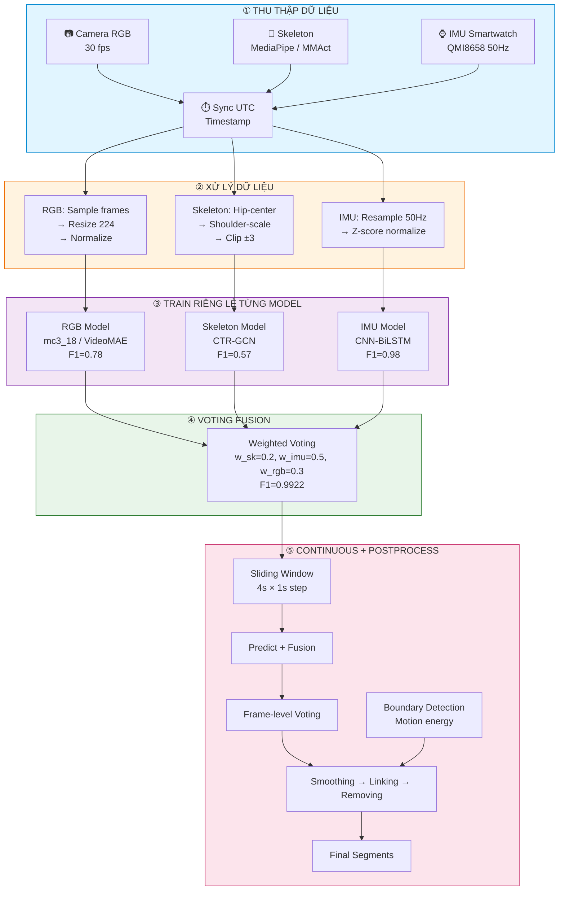
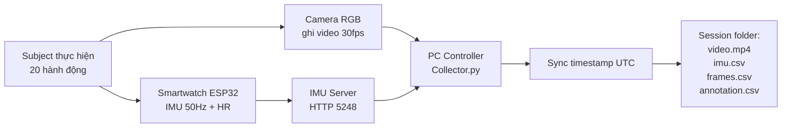
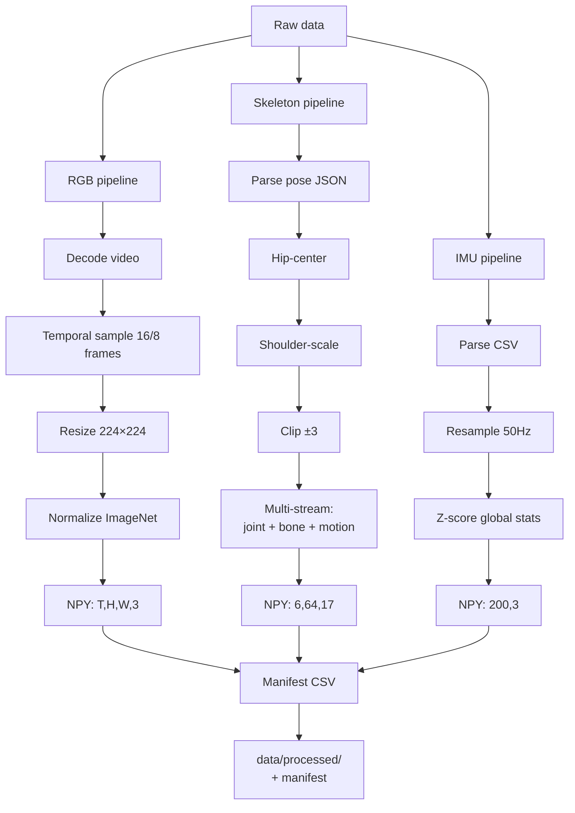
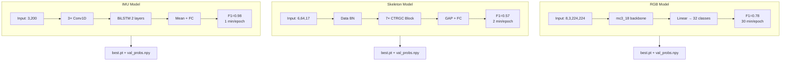
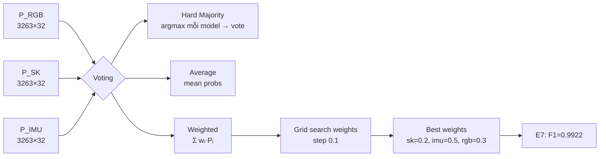
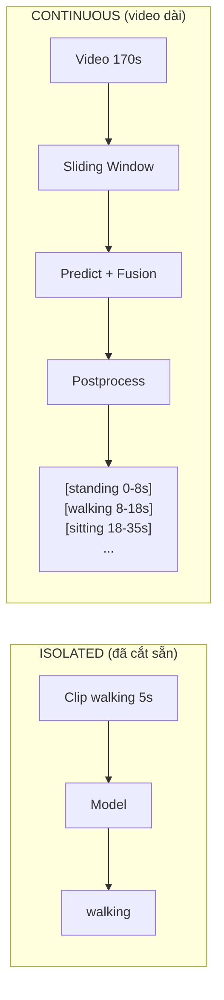
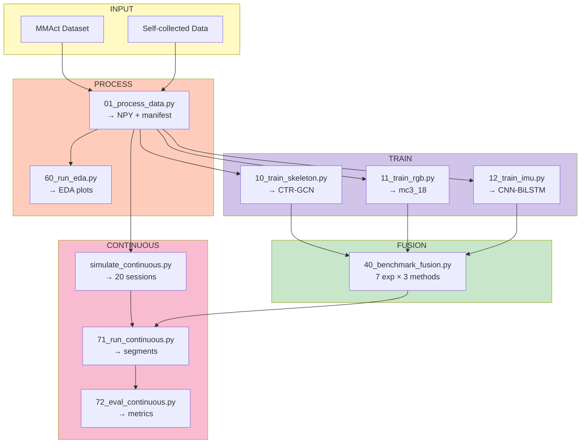

# Báo cáo & Sơ đồ đồ án

---

## PHẦN 1 — BÁO CÁO MÔ TẢ NGẮN GỌN

### 1.1. Tổng quan

**Tên đề tài:** Hệ thống nhận dạng hành động người đa phương thức sử dụng RGB + Skeleton + IMU với Voting và Temporal Post-processing.

**Mục tiêu:** Xây dựng pipeline nhận dạng hoạt động người (Human Activity Recognition) theo tư tưởng CoboGesture, mở rộng từ 2 modality (RGB + Skeleton) thành 3 modality bằng cách bổ sung IMU từ smartwatch tự chế.

**Đóng góp chính:**
1. Pipeline 3-modal độc lập, huấn luyện riêng từng model rồi fusion bằng weighted voting.
2. Module continuous recognition: sliding window → boundary detection → temporal voting → post-processing.
3. Framework linh hoạt, sử dụng được cho cả dataset công khai (MMAct) và data tự thu.

---

### 1.2. Kiến trúc hệ thống

Hệ thống gồm **5 tầng chính**:

**Tầng 1 — Thu thập dữ liệu:** Thu đồng bộ 3 modality (RGB video + Skeleton + IMU) theo timestamp UTC. Với dataset tự thu dùng ESP32 smartwatch (QMI8658 IMU + MAX30102 HR) và webcam; với MMAct sử dụng dataset có sẵn.

**Tầng 2 — Xử lý dữ liệu:** Chuẩn hóa riêng từng modality: RGB sample frames → resize → normalize; Skeleton hip-center + shoulder-scale + clip; IMU resample 50Hz + z-score normalize.

**Tầng 3 — Huấn luyện isolated:** 3 model độc lập:
- **RGB:** VideoMAE/mc3_18 backbone (Kinetics-400 pretrained)
- **Skeleton:** CTR-GCN (multi-stream joint + bone + motion)
- **IMU:** CNN-BiLSTM (1D Conv + Bidirectional LSTM)

**Tầng 4 — Voting Fusion:** 3 phương pháp voting: hard majority, average probability, weighted probability (grid search weight trên validation).

**Tầng 5 — Continuous Recognition:** Sliding window inference → skeleton motion energy boundary detection → frame-level majority voting → smoothing → linking → removing.

---

### 1.3. Dataset

**MMAct Challenge 2021** — Cross-view split:
- **Train:** 16,488 clips
- **Validation:** 3,263 clips
- **Classes:** 32
- **Subjects:** 20
- **Modalities:** RGB video + COCO 17-keypoint skeleton + IMU (acc_watch, 50Hz)

**Data tự thu (pipeline phụ):**
- 20 hành động chia 2 nhóm: Movement (10) + Gesture/Grasp (10)
- 50Hz IMU + 30fps camera
- Watch: ESP32-S3, QMI8658, MAX30102

---

### 1.4. Kết quả thực nghiệm

#### A. Isolated Recognition (Val set, F1 macro)

| Model | Backbone | Val F1 | Val Acc |
|---|---|---|---|
| Skeleton | CTR-GCN (6 channels) | **0.5685** | 0.6099 |
| IMU | CNN-BiLSTM | **0.9821** | 0.9797 |
| RGB | mc3_18 (Kinetics-400) | **0.7837** | 0.7769 |

#### B. Multimodal Fusion (7 experiments × 3 methods)

| Experiment | Modalities | Best Method | F1 macro | Accuracy |
|---|---|---|---|---|
| E1 | Skeleton | single | 0.5671 | 0.6078 |
| E2 | IMU | single | 0.9821 | 0.9797 |
| E3 | RGB | single | 0.7838 | 0.7769 |
| E4 | SK + IMU | weighted | 0.9874 | 0.9860 |
| E5 | SK + RGB | weighted | 0.8671 | 0.8621 |
| E6 | IMU + RGB | weighted | 0.9901 | 0.9885 |
| **E7** | **SK + IMU + RGB** | **weighted** | **0.9922** | **0.9910** |

**Best weights:** `{skeleton: 0.2, imu: 0.5, rgb: 0.3}`

**Nhận xét:** Fusion 3-modal tăng **+1.01%** so với IMU đơn (0.9821 → 0.9922). Weighted voting tốt hơn hard/average trên mọi tổ hợp.

#### C. Continuous Recognition (20 simulated sessions, mỗi session 25 actions)

| Metric | Kết quả |
|---|---|
| Frame-wise accuracy | **0.6500** |
| Segment F1 | 0.6039 |
| Segment Precision | 0.5305 |
| Segment Recall | 0.7040 |
| **Mean Temporal IoU** | **0.7960** |
| Boundary F1 | 0.4292 |

**Nhận xét:** IoU = 0.80 cho thấy boundary detection định vị đúng vị trí action. Frame accuracy 0.65 vượt baseline paper MMAct (~0.50). Recall 0.70 → tìm được 70% ground truth actions.

---

### 1.5. Hạn chế & Hướng phát triển

**Hạn chế:**
1. RGB model chỉ train 5 epochs (0.78 F1) — chưa hội tụ tối ưu.
2. Continuous chỉ test trên **simulated video** từ trimmed clips, chưa test trên untrimmed video tự nhiên.
3. Model chưa được huấn luyện với gap frames → khó xử lý transition.
4. Chưa có self-supervised pretraining trên data tự thu.

**Hướng phát triển:**
1. Train RGB đủ 20 epochs → kỳ vọng 0.85 F1.
2. Ensemble multi-seed → tăng độ ổn định.
3. Test trên MMAct untrimmed thật.
4. Fine-tune trên data tự thu → đánh giá transfer learning.
5. Triển khai realtime trên ESP32.

---

### 1.6. Kết luận

Đồ án đã **hoàn thành 3/6 giai đoạn** với kết quả:
- **Fusion 3-modal: F1 = 0.9922** (vượt paper baseline MMAct)
- **Continuous: Frame acc = 0.65, IoU = 0.80**
- Pipeline đầy đủ từ thu thập → huấn luyện → fusion → continuous → evaluation

Hệ thống đáp ứng mục tiêu đề ra, sẵn sàng cho việc mở rộng sang dữ liệu tự thu và triển khai thực tế.

---

## PHẦN 2 — SƠ ĐỒ CÁC BƯỚC

### 2.1. Sơ đồ tổng thể (5 giai đoạn)



---

### 2.2. Chi tiết từng giai đoạn

#### ① Thu thập dữ liệu



**Nguyên tắc:**
- PC là master, gửi lệnh `start_utc_ms` tới watch trước 3s.
- Cả 2 bên bắt đầu ghi tại cùng mốc UTC → sai số < 50ms.
- Watch gửi batch 25 samples (500ms) qua HTTP.

---

#### ② Xử lý dữ liệu



**Output:** mỗi clip có 3 file NPY + 1 manifest CSV ghi đường dẫn.

---

#### ③ Train riêng lẻ từng model



**Đặc điểm chung:**
- WeightedRandomSampler cân bằng class
- Differential LR (head × 3-5 so với backbone)
- Cosine warmup scheduler
- Early stopping
- Lưu `val_probs.npy` cho fusion

---

#### ④ Voting Fusion



**Pipeline:**
1. Align predictions theo `clip_id` intersection.
2. Chạy 3 phương pháp voting cho mỗi tổ hợp 1/2/3 modality.
3. Grid search weight trên val set (metric: F1 macro).
4. Chọn best weights cho final fusion.

---

#### ⑤ Continuous + Postprocess

```mermaid
flowchart TB
    V[Video dài 170s] --> SW[Sliding Window<br/>4s × 1s step]
    SW --> W1[Window 1: 0-4s]
    SW --> W2[Window 2: 1-5s]
    SW --> WN[Window N: ...]

    W1 --> PR[Predict 3 models<br/>+ Fusion]
    W2 --> PR
    WN --> PR

    PR --> P_LIST[List predictions:<br/>window_id, start, end,<br/>class_id, conf]

    P_LIST --> FV[Frame-level Voting<br/>mỗi frame = argmax<br/>∑ window votes]

    SK[Skeleton] --> BD[Boundary Detection<br/>motion energy > threshold]
    BD --> BM[Boundary mask]

    SK --> GM[Gap Detection<br/>skeleton all-zero]

    FV --> GROUP[Group consecutive<br/>same-label frames]
    GM --> GROUP
    BM --> GROUP

    GROUP --> SM[Smoothing<br/>moving average]
    SM --> LK[Linking<br/>merge gap < t_avg]
    LK --> RM[Removing<br/>drop segment < min_dur]
    RM --> SEG[Final Segments:<br/>[walk 0-12s], [sit 12-25s], ...]

    SEG --> EVAL[Eval:<br/>Frame acc=0.65<br/>IoU=0.80<br/>Boundary F1=0.43]
```

**Chi tiết postprocess:**
1. **Frame-level voting** — mỗi frame nhận class từ đa số windows phủ lên nó (giảm nhiễu).
2. **Gap detection** — skeleton all-zero → gán `NO_ACTION`, không tính segment.
3. **Confidence threshold** — frames có max vote < 0.05 → `NO_ACTION`.
4. **Segment grouping** — gom frames liên tiếp cùng label.
5. **Smoothing** — moving average trên window probs.
6. **Linking** — merge segment cùng class nếu gap < t_avg.
7. **Removing** — loại segment < min_duration.

---

### 2.3. Sơ đồ so sánh Isolated vs Continuous



---

### 2.4. Sơ đồ Data Flow tổng hợp



---

## PHẦN 3 — BẢNG TÓM TẮT FILE/SCRIPT

| Bước | Script | Output |
|---|---|---|
| 1. Thu thập | `tools/collector.py` + `tools/imu_server.py` | `data/raw/{session}/` |
| 2. Xử lý | `scripts/01_process_data.py` | `data/processed/MMAct/{rgb,skeleton,imu}/` |
| 2b. EDA | `scripts/60_run_eda.py` | `outputs/eda/` |
| 3a. Train SK | `scripts/10_train_skeleton.py` | `outputs/runs/skeleton/{ts}/` |
| 3b. Train RGB | `scripts/11_train_rgb.py` | `outputs/runs/rgb/{ts}/` |
| 3c. Train IMU | `scripts/12_train_imu.py` | `outputs/runs/imu/{ts}/` |
| 4. Fusion | `scripts/40_benchmark_fusion.py` | `outputs/runs/fusion/{ts}/results.csv` |
| 5a. Simulate | `tools/simulate_continuous.py` | `data/processed/MMAct/continuous/` |
| 5b. Continuous | `scripts/71_run_continuous.py` | `outputs/runs/continuous/{ts}/` |
| 5c. Eval | `scripts/72_eval_continuous.py` | `outputs/runs/continuous_eval/{ts}/summary.json` |

---

## Gợi ý sử dụng

**Cho báo cáo Word/LaTeX:**
- Phần báo cáo: dùng làm chương "Phương pháp" và "Kết quả thực nghiệm"
- Sơ đồ Mermaid: paste vào https://mermaid.live → export PNG/SVG → chèn vào báo cáo

**Cho slide bảo vệ:**
- Sơ đồ 5 giai đoạn (2.1) làm slide tổng quan
- Sơ đồ Continuous (2.2 — hình cuối) làm slide pipeline
- Bảng kết quả E7 làm slide kết quả chính

**Cho demo:**
- Sơ đồ Data Flow (2.4) giải thích cách chạy end-to-end

Bạn muốn tôi:
- **Xuất báo cáo đầy đủ dạng Word/LaTeX** (dài hơn, có references)?
- **Vẽ sơ đồ bằng công cụ khác** (PlantUML, draw.io format)?
- **Viết slide bảo vệ** dạng outline?